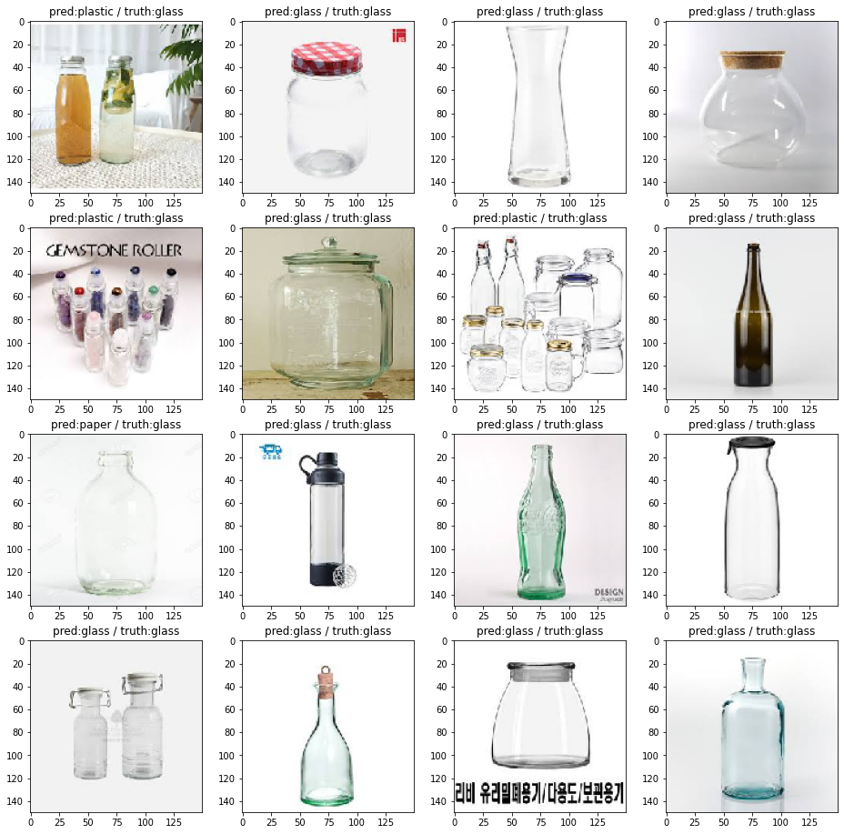

# 필PEEL — Recyclable Waste Image Classification

A CNN that sorts a photo of a discarded item into one of four recycling streams:
**glass, metal, plastic, paper**.

Built for the 필PEEL project, using transfer learning from ImageNet-pretrained
backbones rather than training from scratch — with ~700 images per class, a
pretrained feature extractor is the only approach that converges.

---

## Dataset

| Split | Images per class | Total |
| --- | --- | --- |
| Train | 700 | 2,800 |
| Test | 100 (indices 800–899) | 400 |

Four classes: `glass`, `metal`, `plastic`, `paper`. The notebook builds the
split itself from a flat source directory, copying files into
`train/<class>/` and `test/<class>/` so that Keras's
`ImageDataGenerator.flow_from_directory` can infer labels from the folder names.

Test images are taken from a **disjoint index range** (800–899) rather than
sampled randomly from the same pool used for training — important, because
consecutive indices in this dataset are often near-duplicate shots of the same
object.

## Model

**VGG16** pretrained on ImageNet, used as a frozen feature extractor with the
last three layers left trainable:

```python
vgg = VGG16(weights='imagenet', include_top=False, input_shape=(150, 150, 3))

for layer in vgg.layers[:-3]:
    layer.trainable = False

model = Sequential()
model.add(vgg)
model.add(Flatten())
model.add(Dense(1024, activation='relu'))
model.add(Dropout(0.2))
model.add(Dense(4, activation='softmax'))
```

**InceptionV3** is also loaded for comparison.

Unfreezing only the top three convolutional layers is the compromise that makes
this work at this data scale: the early layers hold generic edge and texture
filters that transfer fine, while the last few need to adapt to what distinguishes
a crushed plastic bottle from a glass one — mostly transparency and
specularity, not shape.

### Training

```python
model.compile(loss='categorical_crossentropy',
              optimizer=Nadam(lr=1e-4),
              metrics=['acc'])

es = EarlyStopping(monitor='val_loss', mode='min', patience=10, verbose=1)
mc = ModelCheckpoint('VGG16 Garbage Classifier.h5',
                     monitor='val_acc', mode='max',
                     save_best_only=True, verbose=1)

history = model.fit_generator(training_set,
                              steps_per_epoch=140, epochs=30,
                              validation_data=validation_set,
                              validation_steps=20,
                              callbacks=[es, mc])
```

A low learning rate (1e-4) is deliberate — the default would wash out the
pretrained weights in the first few batches. Early stopping on `val_loss` with
patience 10, and checkpointing on best `val_acc`, guard against the overfitting
that 2,800 images invites.

Augmentation comes from `ImageDataGenerator`, and `StratifiedKFold` keeps class
balance across folds.

## Setup

```bash
git clone https://github.com/paulms77/pilPEEL.git
cd pilPEEL

pip install tensorflow keras scikit-learn matplotlib numpy
```

Arrange the source images as `glass (0).jpg` … `glass (899).jpg` (and likewise
for the other three classes) in a single directory, then set the paths at the
top of the notebook. The split cells build the directory tree from there.

## Usage

```bash
jupyter notebook garbage_classification.ipynb
```

Run top to bottom. Training writes `VGG16 Garbage Classifier.h5` whenever
validation accuracy improves.

### Prediction

```python
labels = ['glass', 'metal', 'plastic', 'paper']

test_x, test_y = validation_set.__getitem__(1)
preds = model.predict(test_x)

plt.figure(figsize=(16, 16))
for i in range(16):
    plt.subplot(4, 4, i + 1)
    plt.title('pred:%s / truth:%s' % (labels[np.argmax(preds[i])],
                                      labels[np.argmax(test_y[i])]))
    plt.imshow(test_x[i])
```

### Results



*Validation batch, each panel titled `pred / truth`. Most are correct; the
visible failures are glass predicted as plastic and glass predicted as paper —
both transparent-container cases, which is exactly the confusion described
below.*

## Notes

**Glass and plastic are the hard pair.** Both are transparent and both produce
specular highlights, and at 150×150 the cues that separate them — rim thickness,
how light refracts through a fold — are often below the resolution. Most of the
confusion matrix's mass off the diagonal sits there.

**The API here is Keras 2 era.** `fit_generator` is deprecated in favour of
`fit`, and `lr=` is now `learning_rate=`. The notebook is kept as written; on a
current TensorFlow the two calls need renaming.

---

Originally part of
[Another-Competition](https://github.com/paulms77/Another-Competition); split
out into its own repository.
